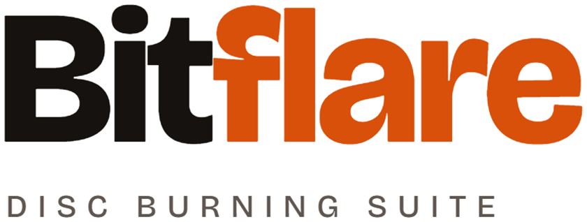
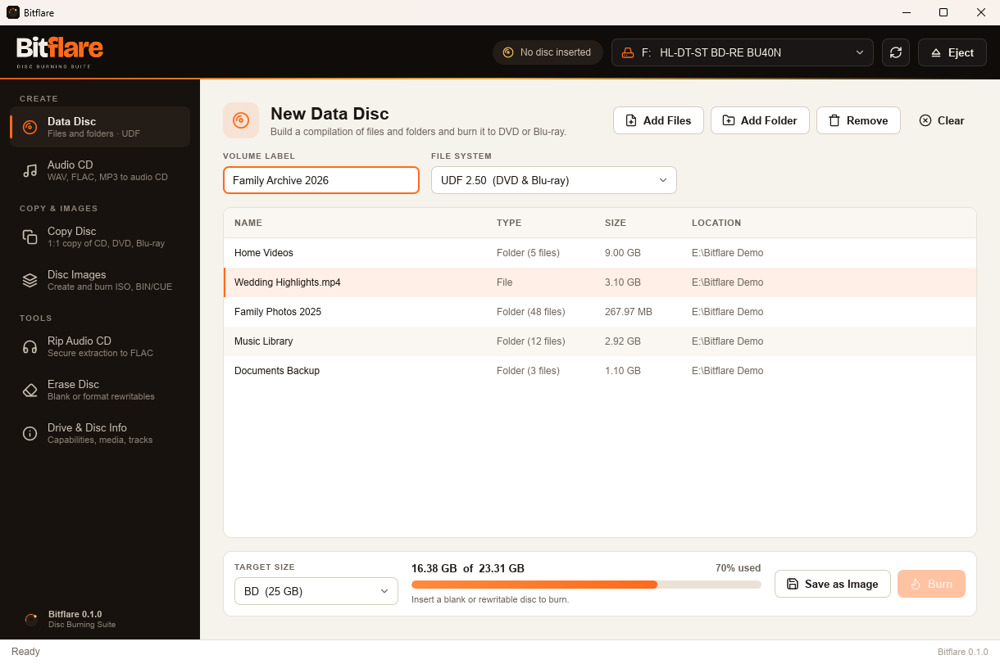
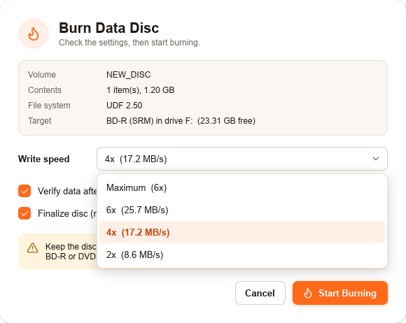
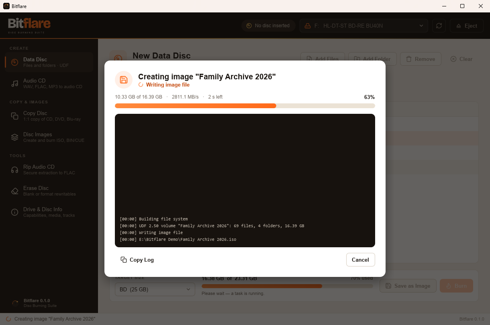
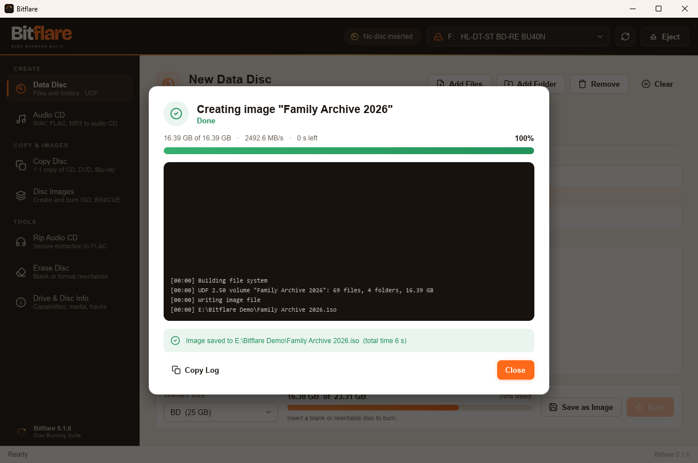
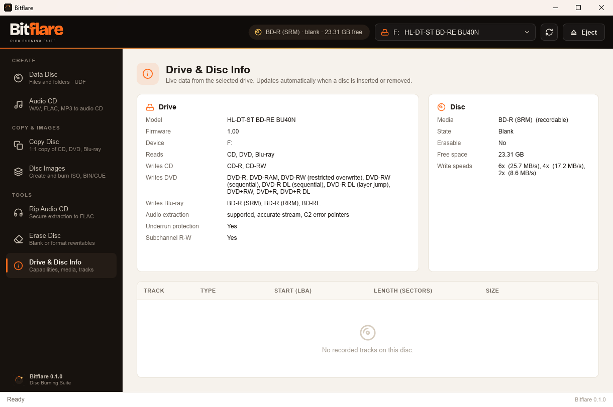
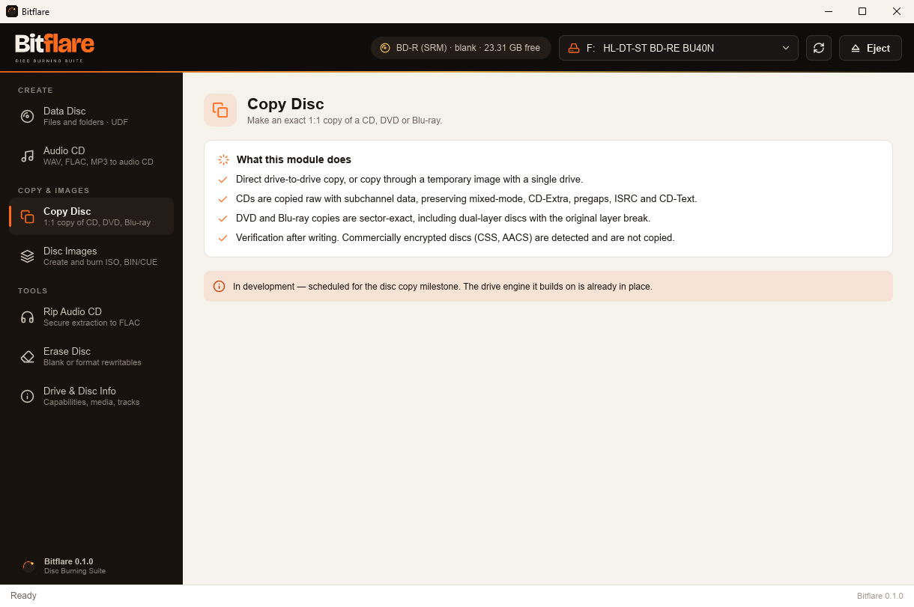

<p align="center">
  
</p>

<h1 align="center">
  <picture>
    <source media="(prefers-color-scheme: dark)" srcset="assets/brand/bitflare-wordmark-on-dark.png">
    
  </picture>
</h1>

<p align="center">
  
  <br>
  <sub>The Data Disc page: build a compilation, see how much of the disc it fills, then burn it or save it as an image.</sub>
</p>

<p align="center">
  <b>Burn data to Blu-ray and DVD, verified byte for byte. A free, open-source disc burning suite, written in pure Rust.</b><br>
  It talks to your drive directly, writes a UDF 2.50 file system without temporary files,<br>
  and reads every sector back to prove the disc is good. No licence key, no activation, no telemetry.
</p>

<p align="center">
  
  
  
  
  <a href="https://github.com/theoddprince/bitflare/actions/workflows/ci.yml"></a>
</p>

<br>

<p align="center">
  <a href="#features">Features</a> ·
  <a href="#supported-discs">Supported discs</a> ·
  <a href="#roadmap">Roadmap</a> ·
  <a href="#command-line">Command line</a> ·
  <a href="#get-started">Get started</a> ·
  <a href="#under-the-hood">Under the hood</a> ·
  <a href="#license-and-credits">License</a>
</p>

<br>

<table>
  <tr>
    <td width="25%" valign="top">
      <h3>🔥 Blu-ray and DVD</h3>
      Burns BD-R, BD-RE, DVD+R, DVD+R DL and DVD+RW, at the write speeds your drive reports for the disc that is actually inserted.
    </td>
    <td width="25%" valign="top">
      <h3>✅ Verified, byte for byte</h3>
      After writing, every sector is read back and compared with your files. "Verified" means the disc really holds what you burned.
    </td>
    <td width="25%" valign="top">
      <h3>⚡ Native and direct</h3>
      A Slint desktop app that sends MMC commands straight to the drive. No Electron, no web view, no IMAPI or cdrtools underneath.
    </td>
    <td width="25%" valign="top">
      <h3>🔒 Plays by the rules</h3>
      Bitflare never decrypts CSS, AACS or BD+. Commercially protected discs are detected and refused, with a clear message.
    </td>
  </tr>
</table>

## Features

### Data Disc

- **Build a compilation** with **Add Files** and **Add Folder**, or pass paths on the command line (`bitflare.exe "D:\Photos" "D:\Videos"`). Folders keep their full structure on the disc.
- **Capacity bar** against the inserted disc or a target size (CD, DVD, DVD DL, BD, BD DL). Sizes use the same units as Windows Explorer, so 25 GB Blu-ray shows as 23.31 GB, just like Explorer.
- **UDF 2.50**, the file system Blu-ray was designed for:
  - no 4 GB file-size limit;
  - long Unicode file names;
  - readable on Windows, macOS, Linux and Blu-ray players.
- **Clear hints** under the capacity bar: ready to burn, doesn't fit, disc finalized, or no disc inserted.

### Burning

<p align="center">
  
</p>

- **Real write speeds.** The speed list comes from the drive itself (GET PERFORMANCE) for the disc in the tray. Bitflare recommends 4x for Blu-ray and 8x for DVD, a reliable middle ground.
- **Verify after burning** (on by default) reads back the whole disc and compares it with the source.
- **Finalize** closes the disc so it reads everywhere. Leave it off to keep the disc appendable.
- **Exclusive access:** while burning, the drive is locked so Explorer, AutoPlay and other programs can't interrupt the write.
- **Safety checks before writing anything:**
  - the disc must be blank (write-once media) or formatted (rewritable media);
  - the compilation must fit, counted to the exact sector;
  - the program must have write access to the drive.

### Progress and logs

<p>
  
  
</p>

- **Live progress:** phase (preparing, writing, flushing, finalizing, verifying), percentage, speed and time left.
- **A full log** of every step, with **Copy Log** to share it.
- **Clear results:** a success or error banner with the exact reason, such as the sector that failed verification.
- **Eject Disc** straight from the finished job.

### Disc images

- **Save as Image** writes the exact disc layout to an `.iso` file instead of a disc. You can mount it in Windows to check it before burning, or burn it later.
- **Streaming:** images and burns are produced on the fly from your files. A 50 GB compilation never needs 50 GB of temporary space.

### Drive & Disc Info



- **The drive:** model and firmware, which CD, DVD and Blu-ray media it reads and writes, audio extraction and buffer-underrun protection.
- **The disc:** media type, state (blank, appendable, finalized), free space, supported write speeds and copy protection.
- **Tracks:** the track list with start, length and size.
- **Updates automatically** when a disc is inserted or removed.

## Supported discs

| Media | Burn | Notes |
|---|---|---|
| **BD-R** | ✅ | Tested on real hardware: 22.9 GB written, finalized and verified. |
| **BD-RE** | ✅ | Must be formatted. |
| **DVD+R / DVD+R DL** | ✅ | |
| **DVD+RW** | ✅ | |
| **DVD-R / DVD-RW** | ⏳ | Needs the write-parameters page; planned. |
| **CD-R / CD-RW** | ⏳ | Track-at-once and disc-at-once writing; planned with audio CD support. |
| **Commercial DVD-Video / Blu-ray** | 🚫 | Copy-protected discs (CSS, AACS, BD+) are detected and never copied. |

## Roadmap

Bitflare is in early alpha. The sidebar already shows every module, and the ones still in development describe what they will do.



| Module | Status |
|---|---|
| Data Disc (UDF 2.50) | ✅ Available |
| Burn to BD-R, BD-RE, DVD+R, DVD+RW with verify | ✅ Available |
| Save as Image (`.iso`) | ✅ Available |
| Drive & Disc Info | ✅ Available |
| Disc Images: create from disc, burn ISO and BIN/CUE | ⏳ Next |
| Erase and format rewritable media | ⏳ Next |
| CD and DVD-R burning, ISO 9660 / Joliet | ⏳ Planned |
| Audio CD (WAV, FLAC, MP3, CD-Text) | ⏳ Planned |
| Rip Audio CD (secure mode, AccurateRip, FLAC) | ⏳ Planned |
| Copy Disc (1:1 CD, DVD, Blu-ray) | ⏳ Planned |
| macOS drive support | ⏳ Planned |
| Installers (MSI, `.dmg`, AppImage, `.deb`) | ⏳ Planned |

## Command line

```sh
bitflare                                   # open the app
bitflare "D:\Photos" "D:\Videos\trip.mp4"  # open the app with these items in the compilation
```

`bitflare-cli` is a console tool for diagnostics and scripting:

```sh
bitflare-cli drives                                  # list optical drives
bitflare-cli info F:                                 # drive features, disc, speeds, burn readiness
bitflare-cli make-image --label "Backup" out.iso D:\Docs D:\Photos   # build a UDF 2.50 image
bitflare-cli eject F:
bitflare-cli lock-test F:                            # check exclusive drive access (writes nothing)
```

Drives can be given as `F:`, `F` or `\\.\F:` on Windows, and as `sr0` or `/dev/sr0` on Linux.

## Get started

You need a stable Rust toolchain, 1.88 or newer, from [rustup.rs](https://rustup.rs).

```sh
git clone https://github.com/theoddprince/bitflare
cd bitflare
cargo build --release
./target/release/bitflare          # Windows: target\release\bitflare.exe
```

| OS | Notes |
|---|---|
| **Windows 10/11** | Builds as-is with the MSVC toolchain. Burning normally works without administrator rights; if a drive refuses access, start Bitflare with **Run as administrator**. |
| **Linux** | The drive engine (SG_IO on `/dev/sr*`) builds and is tested in CI. Add your user to the `cdrom` (or `optical`) group for drive access. The desktop app needs the usual Slint dependencies (`libfontconfig1-dev`, `libxkbcommon-dev`). |
| **macOS** | The app builds, but the IOKit drive backend is not implemented yet, so no drives are listed. |

Tips for a good burn:

- Use good media (Verbatim or Panasonic BD-R) and **4x** on Blu-ray rather than the maximum speed.
- Keep **Verify** on. It roughly doubles the time, and it is the only way to know the disc is readable.
- Keep the computer awake and plugged in until the job finishes.

## Under the hood

```text
crates/bc-scsi    raw MMC/SCSI access: CDB builders, sense decoding, the DriveTransport trait,
                  backends for Windows (SPTI) and Linux (SG_IO), and a mock transport for tests
crates/bc-drive   typed drive queries: inquiry, media profiles, disc and track information,
                  TOC, capabilities, write speeds, copy-protection flags
crates/bc-fs      the UDF 2.50 builder (metadata partition, mirror, extended file entries)
                  and the streamed image it produces
crates/bc-burn    the write engine: target checks, speed, sequential writing, flush,
                  close/finalize, read-back verification
crates/bc-gui     the Bitflare desktop app (Slint): theme, custom widgets, icons, jobs
crates/bc-cli     the bitflare-cli diagnostic tool
```

- **No middleman.** Bitflare sends MMC commands to the drive itself, so it controls write speed, closing and finalizing, and can report exactly which command and sector failed.
- **Checked against the real world.** UDF images are verified by mounting them with Windows' own UDF driver and comparing every file's hash. That includes Unicode names, empty files, and files larger than 1 GB that span several extents.
- **Tested without a drive.** The burn sequence (write, flush, close, finalize) runs against a mock drive in the test suite.
- **CI** lints and tests the engine on Windows, Linux and macOS, and builds the desktop app on Windows, for every push.

## License and credits

The code is dual-licensed under [MIT](LICENSE-MIT) or [Apache-2.0](LICENSE-APACHE), at your option.

- The Bitflare logo and wordmark in [`assets/brand`](assets/brand) belong to the project owner; please use them only to refer to Bitflare.
- Icons are based on [Lucide](https://lucide.dev), used under the ISC License (see [`LICENSE-LUCIDE`](crates/bc-gui/ui/icons/LICENSE-LUCIDE)).
- The screenshots use made-up demo data.
